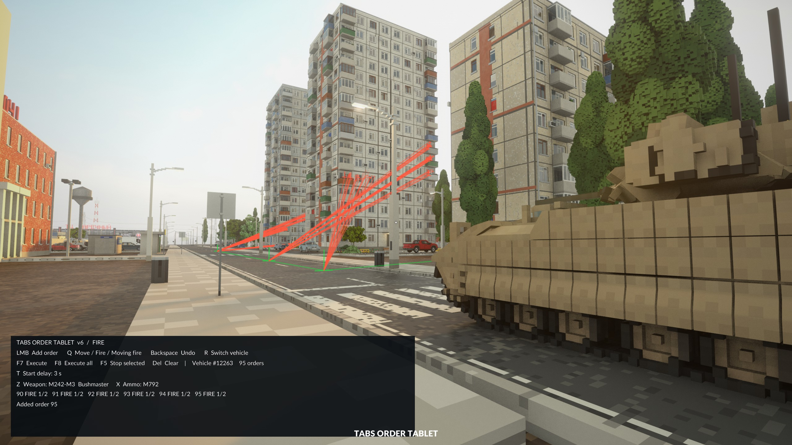

# TABS Fusion

Plan routes, assign firing targets, and coordinate TABS vehicles with a handheld tool in Teardown.

**[Download v0.6.3](https://github.com/swaggyp7/tabs-order-tablet/releases/tag/v0.6.3)** · **[安装教程 / Installation guide](docs/INSTALL.md)** · [Workshop description](docs/WORKSHOP-DESCRIPTION.txt)



## Features

- Combine movement and individual shots in one queue.
- Fire at a target while driving toward a waypoint.
- Choose weapons and ammunition for each firing instruction.
- Track the clicked point on moving bodies.
- Prepare independent vehicle plans and start them together with F8.
- Set each vehicle's start delay to **3 / 5 / 7 / 10 seconds**.
- Compact HUD; press H to expand the controls.

## Choose a download

| Setup | ZIP | Guide |
| --- | --- | --- |
| Fusion only | TABS-Fusion-v0.6.3.zip | [Installation](docs/INSTALL.md) |
| Fusion + Hit Replay | **TABS-Fusion-Hit-Replay-v0.6.3.zip** | **[兼容版教程 / Combined guide](docs/HIT-REPLAY.md)** |

The combined ZIP replaces both main.lua and TABS/scripts/ballistics.lua. Subscribe to the Hit Replay UI separately. Fusion START ALL uses **F6** with the replay bridge; Hit Replay keeps F8/F9/F10. Ordinary Fusion uses F8.

## Installation (Fusion only)

Requires **single-player Teardown**, [TABS Vehicle Framework](https://steamcommunity.com/sharedfiles/filedetails/?id=3148138736), and its required Workshop items.

1. Close Teardown. Open the [release page](https://github.com/swaggyp7/tabs-order-tablet/releases/tag/v0.6.3) and download **TABS-Fusion-v0.6.3.zip** from **Assets**, not the automatically generated **Source code** ZIP.
2. Extract it and find your TABS framework directory:

   ```text
   SteamLibrary/steamapps/workshop/content/1167630/3148138736/
   ```

3. **Back up your original `main.lua`.** Compare its SHA256 with the supported version in [the guide](docs/INSTALL.md) or the ZIP's `INSTALL.txt`. If it differs, do not overwrite it with this replacement.
4. Copy **`TABS-bridge/main.lua`** from the ZIP over **`main.lua` inside that TABS framework directory**. No other TABS files need replacing.
5. Install the tool using one option: use your **Workshop subscription**, or copy the ZIP's entire **`tabs-vehicle-recorder`** folder into **`Documents/Teardown/mods/`**. Enable only one copy.
6. Enable **TABS** and **TABS Fusion**, reload a single-player level, and equip the tool in **group 6**.

**Replace the file inside TABS Vehicle Framework, not inside the Fusion mod folder.** The local folder name `tabs-vehicle-recorder` is retained for compatibility; its in-game name is TABS Fusion.

中文完整步骤见 **[安装教程](docs/INSTALL.md#中文)**。

### What is in the ZIP?

```text
TABS-Fusion-v0.6.3.zip
├── tabs-vehicle-recorder/   Tool mod and preview.jpg
├── TABS-bridge/
│   └── main.lua            TABS framework replacement
├── INSTALL.txt             Setup and restore instructions
└── checksums.json          Supported baseline and packaged file hashes
```

## Your first plan

Left-click a TABS vehicle, then click the ground to add waypoints. Press **Q** for Single shot mode, choose weapon/ammo with **Z / X**, and click a target. Choose the vehicle's delay with **T**, then start with **F7**.

For **moving fire**, select Moving fire target mode and click a target. The tool returns to Route mode: click the ground to set that segment's endpoint. Firing ends at arrival; each moving-fire segment needs its own target.

Use **R** to select another vehicle and prepare its plan. **F8** starts all prepared plans, each with its own countdown. Already running plans are not restarted.

## Controls

| Key | Action |
| --- | --- |
| LMB | Select vehicle / add instruction |
| Q | Route / Single shot / Moving fire target |
| Z / X | Choose weapon / ammunition in target modes |
| F7 | Start selected vehicle's plan |
| F8 / F6 with replay bridge | Start all prepared plans |
| F5 | Stop selected vehicle, including countdown |
| T | Cycle 3 / 5 / 7 / 10 second delay; default 3 |
| R | Select another vehicle; keep plans |
| Backspace / Delete | Undo last instruction / clear selected plan |
| G | Cancel pending moving-fire target |
| H | Expand / hide controls |

## Compatibility and uninstalling

- Requires the TABS version supported by the bridge replacement.
- For **TABS Hit Replay**, use the [combined replacement pair](docs/HIT-REPLAY.md). Do not stack standalone bridge packages; replacing the same file removes the previous patch.
- TABS updates may overwrite the bridge or change compatibility. Check for a compatible release before reinstalling.
- Entering the executing vehicle stops its plan. Entering another vehicle does not. Plans last for the current level only.
- Shots use native ammunition and reloads. Terrain, vehicle motion and turret limits affect firing and accuracy. No ballistic lead prediction.
- To uninstall: close the game, restore **your own pre-install main.lua backup**, and disable Fusion.

If TABS is unavailable in the HUD, check the framework file in the correct Steam library, enable TABS, and reload the level.
