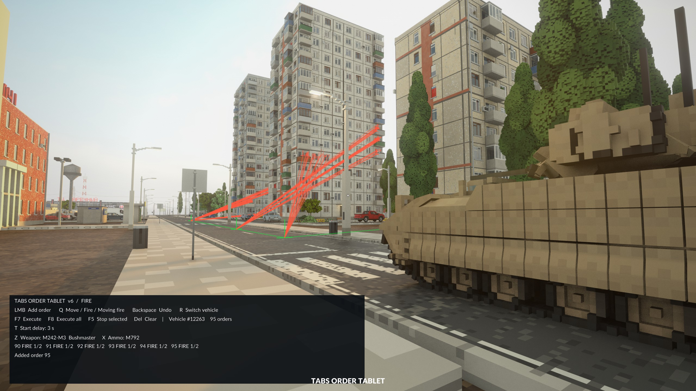

# TABS Fusion

[English](README.md) | **简体中文**

使用手持工具为 Teardown 中的 TABS 载具编排行进路线、射击目标和多车协同动作。

**[下载 v0.6.3](https://github.com/swaggyp7/tabs-order-tablet/releases/tag/v0.6.3)** · [普通版安装](docs/zh-CN/INSTALL.md) · [Hit Replay 兼容版安装](docs/zh-CN/HIT-REPLAY.md) · [完整操作指南](docs/zh-CN/USAGE.md)

## 功能

- 在同一队列中组合移动、停车射击和移动射击。
- 为各条射击指令选择武器与弹种。
- 跟踪动态物体上点击的目标部位。
- 独立保存当前关卡内各辆车的计划，支持同时启动。
- 每辆车可选择 3、5、7、10 秒启动延迟。
- 紧凑界面，按 H 展开完整操作提示。

## 选择下载包

| 使用方式 | ZIP | 教程 |
| --- | --- | --- |
| 只使用 Fusion | TABS-Fusion-v0.6.3.zip | [普通版安装](docs/zh-CN/INSTALL.md) |
| 同时使用 Hit Replay | TABS-Fusion-Hit-Replay-v0.6.3.zip | [兼容版安装](docs/zh-CN/HIT-REPLAY.md) |

需要单人游戏、[TABS Vehicle Framework](https://steamcommunity.com/sharedfiles/filedetails/?id=3148138736) 及其必需项目。仅订阅工具还需要安装桥接文件。

普通版备份并替换 TABS 框架目录的 main.lua；兼容版还需同时备份并替换 TABS/scripts/ballistics.lua。按对应教程核对原文件版本后安装。工具本体可使用工坊订阅版，或把 ZIP 内 tabs-vehicle-recorder 文件夹放入 Documents/Teardown/mods，只启用一份。启用模组、重载地图后，从工具第 6 组拿出 Fusion。

## 开始编排

左键选择载具，在路径模式点击地面添加终点。Q 切换停车射击模式，Z/X 选择武器和弹种，左键添加目标。T 选择启动延迟，F7 执行当前车。

移动射击模式下，先点击目标，再点击地面设置该段终点。车辆在这段行驶期间持续攻击，到达后结束；每段需单独指定目标。

R 切换载具并保留计划。普通桥接用 F8 同时启动全部计划，检测到 Hit Replay 桥接后自动改用 F6，回放保留 F8/F9/F10。已在运行或倒计时的计划不会被重启。

## 按键

| 按键 | 操作 |
| --- | --- |
| 左键 | 选车 / 添加指令 |
| Q | 路径 / 停车射击 / 移动射击目标 |
| Z / X | 目标模式下切换武器 / 弹种 |
| F7 | 执行当前车 |
| F8 / 兼容桥接 F6 | 全部执行 |
| F5 | 停止当前车，包括倒计时 |
| T | 3 / 5 / 7 / 10 秒延迟，默认 3 秒 |
| R | 重新选车并保留计划 |
| Backspace / Delete | 撤销末条 / 清空当前车指令 |
| G | 取消待设置终点的移动射击目标 |
| H | 展开 / 收起操作提示 |

## 兼容性与卸载

- 使用与替换包适配的 TABS 版本。双方独立桥接不能直接互相覆盖，需使用合并兼容包。
- TABS 更新可能覆盖桥接或改变兼容性，安装前重新核对。
- 进入执行中的车辆会停止该车计划；进入其他车辆不影响执行。计划只保留在当前关卡。
- 射击消耗原生弹药并遵循装填，地形、车体运动及炮塔射界会影响开火和命中，不做弹道提前量预测。
- 卸载时退出游戏，恢复自己安装前备份的文件，再禁用工具。

未连接 TABS 时，检查是否替换了正确 Steam 库中的框架文件，确认 TABS 已启用并重载关卡。
